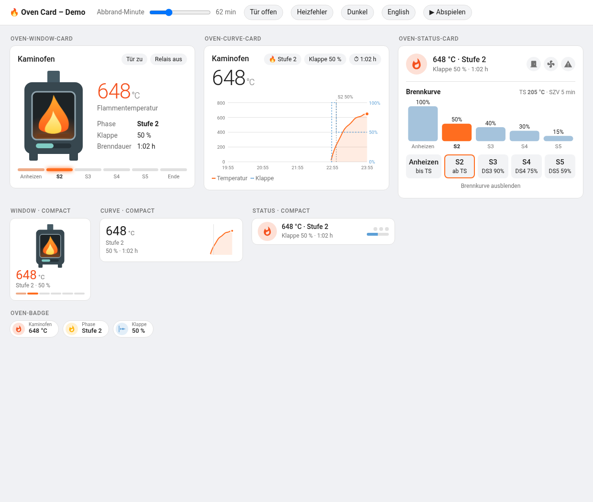
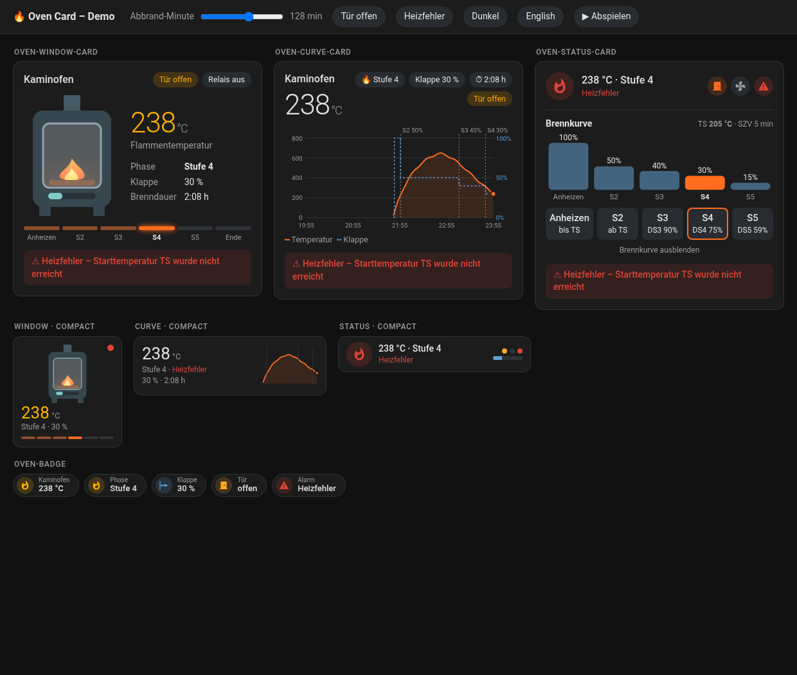

# Oven Card

Dashboard cards and a badge for wood stoves connected with the
[Oven Control](https://github.com/MichScha/oven-control) integration.



| Element | Full | `compact: true` |
|---|---|---|
| `custom:oven-window-card` | Stove window: the flame grows with the temperature, the slot below shows the air flap, phase bar underneath | Square tile with a small stove |
| `custom:oven-curve-card` | Temperature and air flap of the last hours with markers where the stage changes | Value with a sparkline |
| `custom:oven-status-card` | Status row with the configured burn curve (flap per stage, TS, DS3–DS5); the active stage is highlighted | One row in tile height |
| `custom:oven-badge` | Badge for temperature, phase, flap, door or alarm | – |

All elements show door, relay and alarm states; errors (heating error, flame sensor error)
appear as a red notice. A tap opens the details of the entity. Texts are German or English,
following the Home Assistant language.

## Requirements

- Home Assistant 2026.10 or newer
- The [Oven Control](https://github.com/MichScha/oven-control) integration

## Installation

### HACS

1. HACS → ⋮ → *Custom repositories* → add `https://github.com/MichScha/oven-card`, type
   *Dashboard*.
2. Install *Oven Card*. HACS registers the resource; reload the browser.

New releases appear in Home Assistant under *Settings → Updates*.

### Manual

Copy `dist/oven-card.js` to `/config/www/` and add `/local/oven-card.js` as a dashboard resource
of type *JavaScript module* (*Settings → Dashboards → ⋮ → Resources*).

## Configuration

Add the cards with the card picker (search for "Oven") – the editor offers the stove device
and the options below. The cards find the entities through the device, so entity ids
(e.g. `sensor.wohnzimmer_ofen_flammentemperatur`) do not matter. Without `device`, the first
stove is used.

| Option | Cards | Default | Description |
|---|---|---|---|
| `device` | all | first stove | Device id of the stove |
| `name` | all | "Kaminofen" / "Stove" | Title (badge: label of the temperature badge) |
| `compact` | cards | `false` | Small variant |
| `hours_to_show` | curve | `4` | Time range of the curve |
| `show_curve` | status | `true` | Burn curve expanded at start |
| `show` | badge | `temperature` | `temperature`, `phase`, `flap`, `door` or `alarm` |
| `hide_inactive` | badge | `true` | Hide the door and alarm badges while nothing is open or wrong |

```yaml
type: custom:oven-window-card
device: 0123456789abcdef0123456789abcdef
```

```yaml
type: custom:oven-curve-card
compact: true
hours_to_show: 6
```

```yaml
# In the badges of a view
type: custom:oven-badge
show: alarm
```

Phase names: 1 = kindling (waiting for the start temperature TS), 2–5 = stages S2–S5, 8 =
end. Other values are shown as "Phase n".



## Demo

`make serve` serves the repository; `http://<host>:8766/demo/` shows all elements with a
simulated burn (time slider, door, error, dark theme, language).

## Releasing

1. Add a `## [x.y.z] - date` section at the top of [CHANGELOG.md](CHANGELOG.md).
2. `make release VERSION=x.y.z` – sets the version in `dist/oven-card.js`, commits, tags
   `vx.y.z` and pushes.
3. The *Release* workflow checks that tag and card version match and publishes the GitHub
   release with the card file and the changelog section.

## Disclaimer

This is an independent community project. It is not affiliated with, endorsed by or supported
by Ofen Innovativ or Firecontrols. All product and company names are trademarks of their
respective owners and are used here only to describe which devices the cards work with.

## License

MIT, see [LICENSE](LICENSE).
